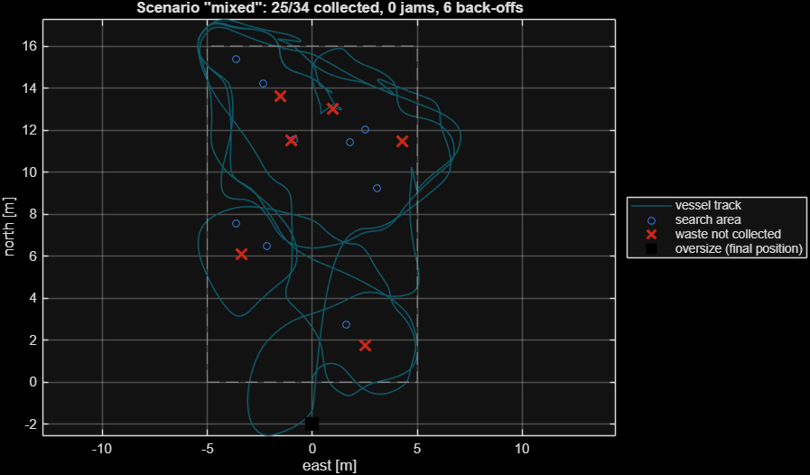
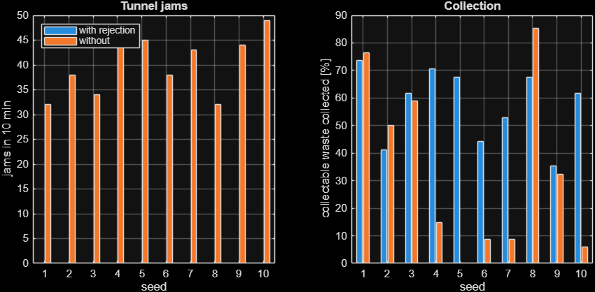

# Ankel-Bot

AI-powered autonomous surface vessel that finds floating waste with an onboard camera, funnels it through a central tunnel into a **detachable rear net**, and physically rejects objects that are too large to collect. Everything runs on the vessel; no internet connection is needed.

Entry for the MathWorks Global Student Challenge 2026.



## What is in this repository

| Folder | Purpose | Status |
|---|---|---|
| `matlab/` | Engineering model in MATLAB: vessel and thruster dynamics, controller design, camera and size-estimation model, mission state machine, collection physics, scenarios, Monte Carlo, tests | Runs. 15/15 tests pass in MATLAB R2026b |
| `matlab/simulink/` + `matlab/+ankel/+sys/` | Simulink model generator and the four MATLAB System blocks it wires | **Not executed** (Simulink was not installed on the development machine). The block logic itself is tested in MATLAB |
| `onboard/` | Python software that runs on the vessel: YOLO26 detector, size estimation, tracker, supervisor, controller, MAVLink link, local storage, optional sync, software-in-the-loop simulator | Runs. 20/20 tests pass. **Never run on hardware** |
| `config/` | `ankelbot_params.json` (generated by MATLAB, read by Python) and `onboard.json` (wiring of one vessel) | |
| `index.html`, `src/` | Interactive 3D model of the machine: assembled, build sequence, exploded, internal and operating views | Runs in a browser |
| `docs/ENGINEERING.md` | Design decisions, rejection mechanism, YOLO26 evaluation, offline architecture, hardware recommendation, results and limits | |

## How MATLAB drives the design

MATLAB is the reference, not an illustration:

1. `ankel.params` holds every physical parameter and threshold once.
2. `ankel.designGains` places the heading and speed loop poles analytically; `ankel.headingStep` verifies them on the nonlinear plant (30° step: 0 % overshoot, 2.6 s rise, 3.2 s settling).
3. `ankel.simulate` closes the whole loop (camera → tracker → supervisor → controller → thrusters → hull → collection) across operating scenarios. This is where the rejection logic was designed: three faults (stale tracks in a current, a back-off deadlock, the rake opening onto a held log) were found and fixed in simulation.
4. `export_reference` writes the parameters and gains to `config/ankelbot_params.json` and writes input/output vectors of every algorithm to `onboard/tests/data/matlab_reference.json`.
5. The Python test-suite replays those vectors. The onboard supervisor must make the same decision as MATLAB at each of 3000 steps of a mission that visits every state.

## Headline results (simulation)

Ten-minute missions, 30–34 collectable items, MATLAB model:

| Scenario | Collected | Tunnel jams | Back-offs |
|---|---|---|---|
| Calm, waste only | 100 % | 0 | 0 |
| Mixed (6 oversize, 4 borderline) | 73.5 % | 0 | 6 |
| Mixed, **rejection disabled** | 76.5 % | **32** | 32 |
| Cross-current 0.063 m/s | 83.3 % | 0 | 14 |
| 2.5× sensor noise | 58.8 % | 0 | 5 |
| Dense (70 items) | 81.4 % | 0 | 5 |

Monte Carlo over 10 debris fields: **0 jams with the rejection system against 40 on average without it**, and 57.6 % against 34.1 % of collectable waste collected.



These are model results with estimated hydrodynamics. Nothing here has been validated on water.

## Run it

MATLAB (base MATLAB is enough):

```matlab
addpath matlab
run_all          % design, scenarios, Monte Carlo, tests, export, figures
```

Simulink (needs Simulink; untested generator):

```matlab
addpath matlab matlab/simulink
build_ankelbot_slx('mixed')
out = sim('AnkelBot');
```

Onboard software on a PC:

```bash
cd onboard
python -m venv .venv
.venv/Scripts/python -m pip install -r requirements.txt
.venv/Scripts/python -m pytest -q
.venv/Scripts/python -m ankelbot sim --scenario mixed --verbose
```

3D model:

```bash
python -m http.server 5173
```

then open `http://localhost:5173`.

## What is not done

- **No trained waste detector.** The code loads any YOLO26 weights, and `tools/train_yolo26.py` trains one, but no floating-waste dataset has been collected or trained on. The stock COCO `yolo26n.pt` was run through the detector on the reference clip: it runs (about 9 FPS on a laptop CPU) but labels the vessel "boat" and finds none of the floating bottles.
- **No hardware.** The MAVLink link is tested only against a simulated autopilot endpoint; servo numbers, mixer direction and IMU signs must be confirmed on the bench.
- **Simulink model not built.** Install Simulink, run the generator, and fix whatever it reports.
- **Hydrodynamic numbers are estimates.** Mass, drag, thrust and therefore speed and endurance need tow and bollard tests.
