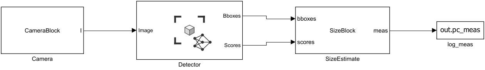
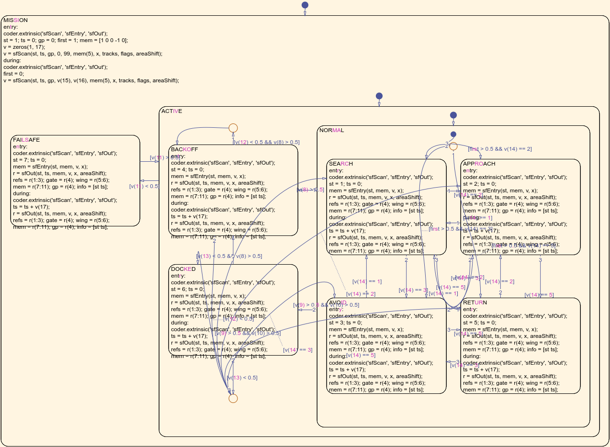
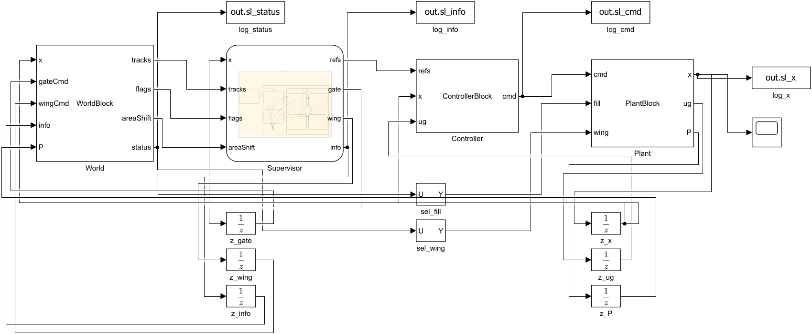

# Ankel-Bot engineering notes

Status key used throughout: **simulated** = run in MATLAB and/or the Python simulator; **bench-pending** = code exists, never run on hardware; **open** = not done.

## 1. Machine

Twin-hull (catamaran) surface vessel, 1.62 m × 1.07 m, with an open tunnel between the hulls.

| Function | Design | Why |
|---|---|---|
| Flotation | Two foam-filled asymmetric hulls, flat inner walls | Flat walls give waste a straight channel; sealed foam hulls cannot flood |
| Front collection | Two hinged mesh wings, sweep 20–60° by linear actuator | Funnel 1.15–2.0 m of surface into a 0.52 m mouth; narrow for tight channels |
| Oversize rejection | Tined rake hinged under the foredeck + steer-around + back-off | See §2 |
| Retention | Spring flap gate mid-tunnel | Waste cannot wash back out when the vessel slows or reverses |
| Storage | Detachable rear net on a slide-in frame, two latches | Full net lifted out and replaced in seconds, vessel stays in the water |
| Propulsion | Two ducted thrusters, one behind each hull, differential steering | Propellers sit outside the waste stream; ducts and guard rails keep the net off the blades; no rudder to foul |
| Electronics | One IP67 enclosure under the aft deck, cable glands, pressure vent | Single sealed volume, 80 mm above the waterline |
| Power | 2 × 25.6 V 40 Ah LiFePO4, one per hull, plus deck solar | Low centre of gravity, level trim as the net fills |

Waste never passes a propeller: it enters between the hulls and leaves into the net on the centreline, while each thruster is 0.40 m off the centreline behind its own hull.

## 2. Oversize rejection

Object detection only produces a decision. Three physical actions carry it out, in order of preference:

1. **Steer around (AVOID).** When a tracked object is classed oversize and its path lies inside the wing corridor, the vessel turns so the object passes outside the wing tip with 0.2 m clearance, slows to 0.35 m/s, and narrows the wing on that side to 20°.
2. **Bar the mouth (reject rake).** The moment a threat is inside 4 m the rake swings down across the tunnel mouth (9 tines at 55 mm pitch, 0.8 s). If avoidance fails, the object stops against the rake instead of wedging in the tunnel. Small waste arriving meanwhile simply waits on the rake and enters when it reopens.
3. **Shed it (BACKOFF).** If an oversize object ends up in the funnel or on the rake, the vessel reverses for 3 s (the object floats free), turns 40° away and resumes. If that does not clear it, the back-off repeats.

Two rules protect against sensing limits:

- The mouth sensor cannot tell a waiting bottle from a log. If an oversize object was tracked inside the funnel in the last 3 s and the mouth is blocked, the rake stays shut and the vessel backs off.
- If the mouth is blocked for 2 s while the rake is open, that is treated as a jam and triggers a back-off.

Accept/reject policy: an object is collectable if its median measured width is ≤ 0.35 m and its class is a waste class. It is rejected if wider, or if most detections give a reject class (branch, log, tyre, vegetation mat, person, boat, bird, animal). The tunnel physically passes 0.42 m, so the policy keeps a 70 mm margin. Unclassified objects closer than 2.5 m are treated as oversize.

Status: **simulated**. Rake actuator, tine spacing and the mouth sensor are design choices, **bench-pending**.

## 3. Size estimation

One camera, no stereo. The bottom edge of a detection box is assumed to lie on the water, 0.55 m below the lens. Each bottom corner back-projects to a point on the water plane, giving range, bearing and the width across the line of sight. IMU roll and pitch remove vessel motion.

Measured in simulation (2 px box noise, 0.7° attitude error):

| Range | Range error (1σ) |
|---|---|
| 2 m | 0.05 m |
| 4 m | 0.28 m |
| 6 m | 0.70 m |

Width error is 0.03–0.05 m mean absolute at nominal noise, 0.14 m at 2.5× noise.


Known limits:

- Only width across the view is measured. A log seen end-on looks narrow, which is why reject classes vote independently of width.
- The box includes the top of the object, which is nearer the lens, so width is overestimated by up to about 5 %.
- A box cut by the image edge only bounds the width from below; the tracker never lets such a box reduce an estimate.
- Waves break the flat-water assumption. Untested.

## 4. YOLO26

Facts from the Ultralytics documentation: YOLO26 was released in January 2026. It has an NMS-free end-to-end head, drops Distribution Focal Loss, and adds small-target-aware label assignment. YOLO26n has 2.4 M parameters and 5.5 B FLOPs, scores 40.9 mAP50-95 on COCO (40.1 end-to-end), and runs in 38.9 ms on CPU (ONNX) and 1.7 ms on a T4 (TensorRT). Licence is AGPL-3.0 or commercial.

**Is YOLO26n sufficient?** For compute, yes with a large margin: the control loop needs 10 Hz. For accuracy it is unknown until a model is trained on floating waste, and there is one specific risk: object size in pixels. A 0.1 m bottle at 6 m is about 13 px wide in a 1280-px frame and about 6 px after downscaling to 640. The simulation assumes a 14 px minimum, which corresponds to running inference at close to full camera resolution.

Recommendation:

- Train `yolo26n` and `yolo26s` on the same data and compare recall on small objects, not overall mAP.
- Run inference at `imgsz` 960 or 1280 on the onboard computer rather than 640.
- Deploy as a TensorRT FP16 engine built on the vessel's own computer.
- Keep `yolo26n` unless `yolo26s` gives clearly better small-object recall; the hardware below runs either.

### MATLAB detector path

MATLAB has no YOLO26, so the MATLAB detector is a second model that shows the detection step inside MATLAB and Simulink; YOLO26 remains the model that runs on the vessel. Both train from the same labelled folder (Ultralytics format), read in MATLAB by `loadYoloDataset`.

| Piece | File | Status |
|---|---|---|
| Dataset loader, anchors, augmentation | `matlab/detector/loadYoloDataset.m`, `wasteAnchors.m`, `wasteAugment.m` | Tested on a synthetic labelled set |
| Transfer learning (YOLO v4 tiny from COCO) | `matlab/detector/trainWasteDetector.m` | **Not run.** Needs the "Computer Vision Toolbox Model for YOLO v4 Object Detection" support package and a dataset |
| Video pipeline: detector, size estimate, verdict | `matlab/detector/detectOnVideo.m` | Tested with a stand-in detector |
| Simulink: camera, Deep Learning Object Detector block, size estimation | `matlab/simulink/run_perception.m`, `AnkelPerception.slx` | Runs with the toy fixture detector |

The toy fixture (`makeToyDetector.m`, `toyDetector.mat`) is a small YOLO v2 network trained for three minutes on synthetic bright rectangles. It is not a waste detector; it exists so the Simulink wiring can be executed and checked now. In the Simulink run a synthetic camera draws two objects of known size: both were detected in all 31 frames, the width error was 4.7 % for the 0.8 m object and 13 % for the 0.3 m object, and the 0.8 m object was rejected in every frame. The 0.3 m object got the right verdict in 77 % of frames, because 0.3 m plus the error sits on the 0.35 m limit; this per-frame flicker is what the tracker's median over several frames removes on the vessel.



To run the real model through the same wiring: `trainWasteDetector(dataRoot)` then `run_perception('matlab/detector/wasteDetector.mat')`. The perception model is separate from `AnkelBot.slx`, whose closed loop simulates detections geometrically rather than from images.

Still needed for real training: the YOLO v4 support package; Parallel Computing Toolbox and a CUDA GPU (training is CPU-only on the development machine, which is impractical for thousands of images); and a dataset. FloW-Img (about 2000 images of floating waste, access by application) and WSODD (7467 images, 14 classes of water-surface objects) are useful starting data, but own images from the vessel's 0.55 m viewpoint, including the reject classes, are still needed. `yolov8ObjectDetector` is not a built-in function; it comes from a MathWorks GitHub repository under AGPL-3.0. Deploying a MATLAB-trained model to a Jetson would need GPU Coder.

What was actually run here: stock COCO `yolo26n.pt` through `ankelbot.detector` on the reference clip, laptop CPU, PyTorch runtime: median 106 ms per frame (9.4 FPS). It detected the vessel as "boat" and no floating bottles. A waste-specific model is required. Status of the trained model: **open**.

## 5. Offline architecture

```
camera ──► YOLO26 (local) ──► size estimation ──► tracker ──► supervisor ──► controller
                                                                 │               │
   IMU, GNSS, battery, range sensors ◄── MAVLink ── autopilot ◄──┴── thrust, wings, rake
                                                                 │
                                                        SQLite on local disk
                                                                 │
                                              optional upload when docked and online
```

- Detection, tracking, decisions and control all run on the companion computer.
- The autopilot (ArduPilot Rover, skid-steer boat) drives the ESCs and keeps the safety functions: RC takeover by a person, arming checks, failsafe if the companion stops sending.
- Navigation uses GNSS and compass only. No map tiles, no cloud service.
- Every detection, state change and telemetry sample goes to a local SQLite file in WAL mode.
- `sync.py` uploads unsynced rows over HTTP only when an endpoint is configured, and only while docked. Any failure leaves the data on disk. It is disabled by default.
- Loss of camera frames, autopilot heartbeat, attitude or position puts the supervisor in FAILSAFE: thrust zero, rake closed.

## 6. Onboard hardware

Published YOLO26n measurements at about 5 W (one independent case study; inference at the study's default input size):

| Platform | End-to-end FPS | mAP50-95 | Power |
|---|---|---|---|
| Jetson Orin Nano 8 GB, TensorRT FP16, 7 W mode | 56.9 | 0.402 | 4.6 W measured |
| Raspberry Pi 5 + Hailo-8L | 70.9 | 0.375 | 3.9 W estimated |
| Raspberry Pi 5 + Hailo-8 | 83.8 | 0.375 | 4.8 W estimated |
| Raspberry Pi 5, CPU only | about 8 (ONNX) to 15 (NCNN, inference only) | 0.401 | — |

**Recommended: Jetson Orin Nano 8 GB.** It keeps full accuracy (no quantisation loss), has headroom for higher input resolution or `yolo26s` (34.5 FPS in the same study), and needs no separate accelerator toolchain. Its draw is small against the 25 W hotel budget and the 2 kWh battery.

**Lower-cost alternative: Raspberry Pi 5 + Hailo-8L.** Faster and cheaper, but loses about 2.7 mAP points to quantisation and needs the Hailo compiler in the export path. A Pi 5 on CPU alone is too close to the 10 Hz requirement.

Other parts: a Pixhawk-class autopilot running ArduPilot Rover; an IP67 1080p camera; two brushless thrusters of about 350 W with marine ESCs; three waterproof PWM actuators (two wings, rake); time-of-flight sensors at the mouth and net; two waterproof ultrasonic rangers. Prices change quickly and are not listed; check current ones before ordering.

## 7. Control design

Model: 3-DOF surge/sway/yaw with added mass, linear plus quadratic damping, first-order thruster lag, thrust proportional to command squared, and extra drag from wing sweep and net fill (`vesselDeriv.m`).

- Heading: PD with rate feedback, poles placed at ωn = 1.2 rad/s, ζ = 0.9, giving Kp = 40.3 N·m/rad and Kd = 52.5 N·m·s/rad.
- Speed: PI with drag feed-forward, ω = 0.6 rad/s, ζ = 1.
- Allocation: yaw first, surge with what is left, square-root inverse of the thrust curve, conditional-integration anti-windup.


Verified on the nonlinear plant: 30° step with 0 % overshoot, 2.6 s rise and 3.2 s settling; 0.5 m/s held within 0.02 m/s; model top speed between 1.2 and 2.2 m/s. Model endurance at collecting speed is about 15 h (133 W average). All of this rests on estimated drag and thrust: **bench-pending**.

## 8. Mission logic

States: SEARCH (lawnmower over a rectangle), APPROACH (nearest collectable track), AVOID, BACKOFF, RETURN (net full or battery below 20 %), DOCKED, FAILSAFE (health lost or battery below 8 %).


Surface drift: all floating objects ride the same current, so the tracker estimates one drift vector from track motion, predicts unseen tracks with it, and shifts the search pattern so it stays over the waste. In the MATLAB cross-current scenario the estimate was (0.017, 0.058) m/s against a true (0.02, 0.06) and 83 % of the waste was collected with no jams. The onboard tracker, which uses only fixes closer than 3.5 m, estimated (0.013, 0.087) m/s in the same scenario.

## 9. MATLAB model versus onboard code

| Algorithm | MATLAB | Python | Checked by |
|---|---|---|---|
| Thrust map, controller, allocation | `controlLaw.m` | `control.py` | 300 random vectors, 1e-9 |
| Camera projection, size estimate | `cameraProject.m`, `estimateFromBBox.m` | `geometry.py` | 300 vectors, 1e-6 |
| Accept/reject rule | `classifyTrack.m` | `tracker.classify` | 7 cases |
| Vessel dynamics | `plantStep.m` | `plant.py` | 300-step trajectory, 1e-8 |
| Supervisor | `supervisorStep.m`, Stateflow chart | `supervisor.py` | 3000-step mission through all 7 states (Python); every step of five scenarios (chart) |
| Tracker | by identity (idealised) | bearing/range association | **not equivalent**, see below |

The tracker is the one place the two differ on purpose. MATLAB knows which detection belongs to which object; the vessel does not. With the real tracker the Python simulator gives lower throughput on the mixed scenario: 59–79 % collected over four debris fields against MATLAB's 73.5 %, with more back-offs (6–21 against 6). Jams were zero in every run of both. Closing that gap is tuning work on association and avoidance.

## 10. Simulink model

`AnkelBot.slx` is a discrete model at 0.1 s: a Stateflow chart for the mission supervisor, MATLAB System blocks for World, Controller and Plant, and unit delays closing the two feedback paths. It is generated by `build_ankelbot_slx.m` and `add_supervisor_chart.m`.

The chart owns the mission structure. MISSION scans the inputs every step and contains FAILSAFE and ACTIVE; ACTIVE contains BACKOFF, DOCKED and NORMAL; NORMAL contains SEARCH, APPROACH, AVOID and RETURN. Outer transitions carry the priorities (health first, then back-off, then docking). The conditions it tests and each state's outputs come from the same functions the MATLAB reference uses (`supScan`, `supEntry`, `supOutputs`).

`run_simulink.m` simulates the model and compares it with `ankel.simulate`. Vessel state and supervisor state are identical at every step in the mixed, cross-current, low-battery and link-loss scenarios (and in the dense scenario, checked separately); the rejection-disabled scenario uses a MATLAB System supervisor and also matches.





Limits: the blocks run in interpreted mode and the chart calls its helpers extrinsically, so the model simulates but is not prepared for code generation. The chart's transitions are auto-routed and cluttered; tidy them in the Stateflow editor before presenting.

## 11. Tests

MATLAB, `runtests('matlab/tests')`, 21 tests (16 model tests, 5 detector-path tests). Model tests: thrust map inverse, speed hold, heading step specification, top speed, size estimate with and without roll, classifier, calm collection, rejection prevents jams, no rejection produces jams, low-battery return, health loss stops thrusters, block wiring reproduces the simulation, the Simulink model reproduces the simulation, drift estimate, cross-current collection.

Python, `pytest`, 20 tests: the six MATLAB reference checks above; six tracker tests; six end-to-end simulated missions (calm, oversize over three seeds, cross-current, low battery, health loss, local logging); storage and sync against a local HTTP server, including the offline case; MAVLink encode/decode against a simulated autopilot endpoint.

## 12. Before the first water test

1. Collect and label images from the vessel's own camera height; train and evaluate the detector.
2. Calibrate the camera (intrinsics, mounting height and tilt) and replace the values in `params.m`.
3. Bench-test the MAVLink link with propellers removed: mixer direction, servo outputs, roll and pitch signs, failsafe on companion loss.
4. Measure bollard thrust and tow drag; update `params.m`; rerun `run_all`.
5. Tank or pond test of the rake and back-off with real debris.

## Sources

- Ultralytics YOLO26 documentation: https://docs.ultralytics.com/models/yolo26/
- YOLO26 on Jetson Orin Nano and Hailo at about 5 W: https://danieldubinsky.github.io/personal-site/case-studies/yolo26-jetson-vs-hailo/
- Ultralytics Raspberry Pi guide: https://docs.ultralytics.com/guides/raspberry-pi
- Arm learning path, YOLO26 on Raspberry Pi 5: https://learn.arm.com/learning-paths/embedded-and-microcontrollers/yolo26-arm-runtime/compare-performance/
